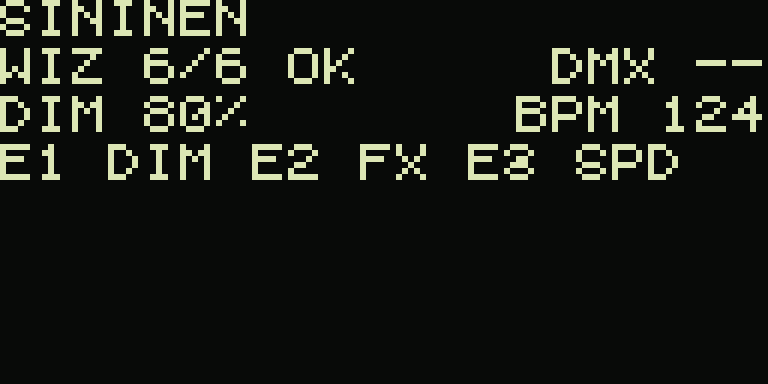
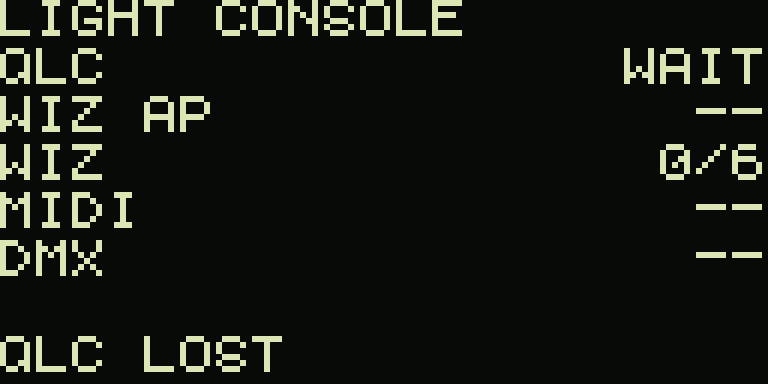

# Shield XL Light Console

Standalone lighting console UI for **Raspberry Pi 4 + Denki Oto shieldXL**. QLC+ is the show engine. This repository is **new and separate** from the production wiz-bridge Pi and from the Norns Shield SD card.

**Milestone 0.1.0** — architecture, hardware research, Mac OLED simulator. Nothing is deployed to a Raspberry Pi.

## Mac simulator

```bash
cd shieldxl-light-console
python3.11 -m venv .venv
source .venv/bin/activate
pip install -e ".[sim,dev]"
python -m simulator.run
```

A window shows a **128×64 OLED** (scaled) plus a control strip.

Static dumps of the framebuffer (no window required):




| Input | Action |
|-------|--------|
| Q / A or ← → | Encoder E1 (dimmer) |
| W / S or ↑ ↓ | Encoder E2 (select / menu) |
| E / D or `,` `.` | Encoder E3 (speed / BPM) |
| Z or 1 (hold = long) | K1 blackout / all off |
| X or 2 (hold = long) | K2 GO / home |
| C or 3 (hold = long) | K3 special / menu |
| F1 | QLC connected / lost |
| F2 | Launchpad present / missing |
| F3 | PKNight node OK / -- |
| F4 | upstream Wi-Fi |
| F5 | WIZ-LIGHTS AP |
| `-` / `=` | WiZ online −1 / +1 |
| 0 / 6 | WiZ 0/expected or full |
| ESC | quit |

Headless dump (no pygame window):

```bash
python -m light_console.main --headless --dump-screen /tmp/oled.txt --screenshot /tmp/oled.ppm
```

Tests:

```bash
python -m pytest
```

## What this is not

- Not a replacement for QLC+ or wizbridge
- Not a Norns image
- Not a deploy onto `valot.local` or the existing Norns microSD

Hardware facts and UNKNOWN pins: [`research/shieldxl.md`](research/shieldxl.md). Architecture: [`docs/architecture.md`](docs/architecture.md).

## Version

| Ver | Meaning |
|-----|---------|
| 0.1.0 | Simulator + docs (now) |
| 0.2.0 | Shield XL hardware proof on a **new** SD — gated: [`docs/milestone-0.2-hardware-bringup.md`](docs/milestone-0.2-hardware-bringup.md) |
| 0.3.0 | QLC WebSocket |
| 0.4.0 | Network / status |
| 0.5.0 | Pi standalone prototype |
| 1.0.0 | Show-ready |
